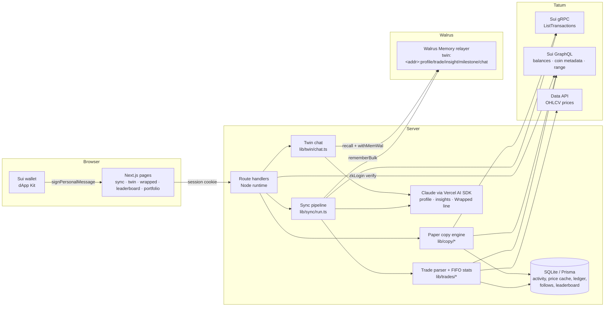

# WalletTwin

**Your Sui wallet has a memory. Meet the twin that kept it.**

WalletTwin reads a wallet's on-chain history through **Tatum**, turns it into trades, wins,
losses, habits and milestones, and stores what it learns as an AI twin in **Walrus Memory**.

- **Chat with your twin:** "Why do I keep losing on MAGMA?", "What's my worst habit?"
- **Wallet Wrapped:** a shareable card with your stats and a one-liner.
- **Publish your twin (opt-in):** appear on a public leaderboard, with a public chat that only
  sees your profile, insights and milestones.
- **Paper-copy another twin:** $1,000 of simulated money mirrors a leader's swaps. A simulated
  0.5% fee shows what the copy-volume model would pay the leader.

Built for the Tatum × Walrus **Total Recall** hackathon (Consumer Finance track). Copy
trading is **simulated**: no real trades, no real funds. Not financial advice.

---

## How Tatum is used

Every on-chain read on the server goes through [`lib/tatum/`](lib/tatum/index.ts), the only
module that talks to Tatum.

| What | Tatum product | Code |
| --- | --- | --- |
| Wallet history, newest first, capped at 1,000 tx per sync, incremental by checkpoint | Sui gRPC gateway, `LedgerService/ListTransactions` (native gRPC over HTTP/2). Reaches back to Jan 2026 (~9 months) | [`lib/tatum/sui-grpc.ts`](lib/tatum/sui-grpc.ts) |
| Same history over GraphQL (fallback, ~90 days), indexed range, coin metadata, balances | Sui GraphQL gateway | [`lib/tatum/sui-graphql.ts`](lib/tatum/sui-graphql.ts) |
| Historical USD price of each trade (hourly candles, cached; unknown means unknown) | Data API `GET /v4/data/rate/symbol/OHLCV` | [`lib/tatum/prices.ts`](lib/tatum/prices.ts), [`lib/trades/price-cache.ts`](lib/trades/price-cache.ts) |
| Sign-in signature checks (zkLogin wallets need on-chain lookups) | Sui GraphQL gateway via `@mysten/sui` | [`lib/tatum/index.ts`](lib/tatum/index.ts) → [`app/api/auth/verify/route.ts`](app/api/auth/verify/route.ts) |
| Leader balance snapshots and polling for new leader swaps (copy trading) | GraphQL `address.balances` + gRPC history | [`lib/copy/service.ts`](lib/copy/service.ts) |

- **Rate limit:** one rate gate keeps HTTP and gRPC under the free plan's shared 3 req/s,
  with `Retry-After`-aware retries ([`lib/tatum/http.ts`](lib/tatum/http.ts)).
- **Why not JSON-RPC:** Sui disabled JSON-RPC on mainnet in July 2026. See [TODO.md](TODO.md)
  for everything we verified live.

## How Walrus Memory is used

[`lib/memory/`](lib/memory/index.ts) wraps the MemWal SDK (`@mysten-incubation/memwal`).

**One namespace per wallet and memory type:** `twin:<address>:profile | trade | insight |
milestone | chat`. Walrus Memory has no tag filter, so the privacy rule is structural. Public
chat only queries the `profile`, `insight` and `milestone` namespaces; your `[chat]` facts
and individual `[trade]`s are never even read on a public route
([`lib/memory/namespaces.ts`](lib/memory/namespaces.ts)).

**What gets remembered, and how the twin "learns over time":**

| Memory | Written when | Code |
| --- | --- | --- |
| `[trade]` one entry per meaningful trade: date, tokens, amounts, ≈USD, outcome, holding time | Each sync, for new activity only | [`lib/twin/memories.ts`](lib/twin/memories.ts) |
| `[milestone]` firsts and records: first swap or NFT, biggest win, worst loss, largest trade, swap-count marks | A new record becomes a new memory (keys embed the record's digest) | [`lib/twin/memories.ts`](lib/twin/memories.ts) |
| `[profile]` + `[insight]` trading style and data-backed habits, written by Claude from computed features | Regenerated when new activity arrives; the newest is read with `sort: "recent"` | [`lib/twin/narrative.ts`](lib/twin/narrative.ts) |
| `[chat]` facts you tell your twin ("I'm saving for a house") | During chat, via MemWal's `withMemWal` middleware (`analyze()`), scoped to `twin:<addr>:chat` | [`lib/twin/chat.ts`](lib/twin/chat.ts) |

**Idempotent re-sync:** every write goes through a `(address, key)` ledger in SQLite
([`prisma/schema.prisma`](prisma/schema.prisma) `MemoryWrite`), so a trade digest is never
stored twice. Re-running a sync with nothing new writes nothing.

**Writes are asynchronous on the relayer:** embed → Seal-encrypt → Walrus blob → Sui
transaction. We submit bulk jobs of 20 and poll their status; `/sync` shows how many are
confirmed.

> **Local stand-in:** if `MEMWAL_PRIVATE_KEY` / `MEMWAL_ACCOUNT_ID` are missing, a local SQLite
> store is used so the app still runs in development. The UI labels this clearly
> ("Memory · local stand-in"). Production and the hackathon demo use Walrus.

## Architecture



## Pages

| Route | What it does |
| --- | --- |
| `/` | Pitch, demo twins (no wallet needed), top 5 twins |
| `/sync` | Sign-in proof, then live progress: Tatum history → classify and price → profile → Walrus |
| `/twin/me` | Private chat + stats panel (realized PnL estimate, win rate, swaps, holding time, favorite tokens) + publish toggle |
| `/wrapped` | Wallet Wrapped card (PNG), download, share to X, copy link (`/w/[address]?t=…`) |
| `/leaderboard` | Published twins ranked by simulated copy return, then win rate and PnL |
| `/twin/[address]` | Public twin: profile, insights, milestones, stats, public chat, paper-copy button |
| `/portfolio` | Paper portfolios: value, PnL, holdings, recent copied trades, fees, "leader would have earned" |

## Setup

Requirements: Node 24+, pnpm (`corepack enable`).

```bash
pnpm install
```

```bash
cp .env.example .env.local
```

Fill in `.env.local` (a plain `.env` works too):

- `SESSION_SECRET`: 32+ random characters (`openssl rand -base64 48`)
- `TATUM_API_KEY`: from [dashboard.tatum.io](https://dashboard.tatum.io)
- `MEMWAL_PRIVATE_KEY`, `MEMWAL_ACCOUNT_ID`: from [memory.walrus.xyz](https://memory.walrus.xyz) (mainnet relayer is the default)
- `ANTHROPIC_API_KEY` (+ `ANTHROPIC_WORKSPACE_ID` if your key isn't scoped to a workspace)

```bash
pnpm db:migrate
```

```bash
pnpm seed
```

```bash
pnpm dev
```

`pnpm seed` syncs and publishes the demo wallets (override with `DEMO_WALLETS`). After running
a migration, restart `pnpm dev`: the dev bundler keeps the previously generated Prisma client
loaded.

In development, dApp Kit offers an **Unsafe Burner Wallet** so you can test sign-in without a
browser extension. It is disabled in production builds.

## Scripts

| Command | What it does |
| --- | --- |
| `pnpm dev` / `pnpm build` | Next.js dev server / production build |
| `pnpm test` | Unit + integration tests (recorded Tatum fixtures, throwaway SQLite DB) |
| `pnpm test:e2e` | Playwright end-to-end suite (see below) |
| `pnpm test:live` | Live checks against Tatum mainnet: gRPC vs GraphQL cross-check, history depth, prices (uses credits) |
| `pnpm typecheck` / `pnpm lint` | `next typegen` + TypeScript / ESLint |
| `pnpm analyze <address>` | Run Tatum → parser → prices → stats for any wallet and print the stats |
| `pnpm sync:wallet <address>` | Full twin sync for one wallet from the CLI |
| `pnpm seed` | Sync + publish the demo twins |
| `pnpm check:services` | Pre-flight: Tatum, Walrus Memory relayer and Anthropic reachable with your keys |

## End-to-end tests

`pnpm test:e2e` runs 15 Playwright tests in your installed Google Chrome (`channel: "chrome"`,
no browser download). It starts its own dev server on port 3100 with an isolated build dir
(`build/e2e`), a freshly migrated and seeded database (`prisma/e2e.db`,
[`scripts/e2e-seed.ts`](scripts/e2e-seed.ts)), and the local memory backend, so a run never
touches your dev data or writes test twins to Walrus.

Covered flows:

- **Landing and nav:** pitch, demo twins, top twins, every section.
- **Sign-in and sync:** dev burner wallet signs the message, the sync runs through Tatum, sign-out.
- **API guards:** cross-site, unauthenticated, forged demo login and bad share token.
- **Demo twin:** seeded stats, the demo restrictions, and chat (a reply, or a friendly error when the LLM is unavailable).
- **Wrapped:** the PNG renders, the share-to-X link, the public share page with og:image, a wrong token.
- **Leaderboard and public twin:** ranking, and private `[chat]`/`[trade]` memories never appear on the public page.
- **Paper copy trading:** follow → $1,000 portfolio → poll → stop.
- **Publishing:** publish → leaderboard → unpublish.
- **Phone layouts:** no horizontal overflow at Pixel 7 size.

Every test also fails on uncaught page errors, unexpected console errors, or any 5xx from the
app. The sync and follow flows call Tatum with your key. The HTML report is written to
`build/playwright-report`.

## 2-minute demo script

1. **0:00 Landing.** "Your wallet has a memory." Click **Explore as this wallet** on *The MAGMA
   scalper*, a real Sui mainnet wallet. (Or connect your own wallet and sign one gas-free
   message.)
2. **0:15 /sync.** Re-sync: Tatum pages the wallet's history over gRPC (9 months indexed),
   every swap is priced from Tatum OHLCV, and memories are committed to Walrus. Re-syncing
   writes nothing new, because the ledger is idempotent.
3. **0:35 /twin/me.** The stats panel shows 869 swaps, a 42% win rate and about −$1,657
   realized. Ask *"What's my worst habit?"*. The twin answers in first person from recalled
   `[insight]`/`[trade]` memories. Tell it *"I'm saving for a house"*; with your own wallet,
   `withMemWal` saves that as a `[chat]` fact.
4. **1:00 /wrapped.** The generated card shows 869 swaps, a 7.0h average hold, "Median hold:
   6.1h. Commitment issues, but make it on-chain." Click **Share on X**: the link unfurls with
   the card.
5. **1:20 /leaderboard → public twin.** The public page shows the profile, insights and
   milestones only; the public chat cannot see `[chat]` or `[trade]` memories. Copy return
   +15.2% is the same engine backtested over its history.
6. **1:40 Paper-copy.** Click **Paper-copy this twin · $1,000 simulated** → `/portfolio`.
   New leader swaps are pulled through Tatum and mirrored proportionally. The 0.5% fee split
   shows **"Leader would have earned $X"**: the copy-volume business model, entirely simulated.

## Design notes and limits

- **Estimates, never guesses.** USD values come only from Tatum OHLCV for verified coin types
  (SUI, USDC, WAL, CETUS, HAEDAL), matched by full coin type so an impostor "USDC" is never
  priced. Trades without a reliable price are excluded from PnL. Sales of positions opened
  before the history window are excluded from win rate. Prices are quoted in USDT (≈USD).
- **History depth:** about 9 months (Tatum gRPC index), with a 1,000-transaction cap per sync
  to bound credits.
- **Copy return ≠ leader PnL.** The paper engine sizes each copy as the same *fraction* of the
  position the leader traded, and starts the follower in cash. A leader with large losing
  trades in dollar terms can still have a positive proportional copy return, and vice versa.
  SUI and stablecoins map to paper cash: the follower takes no SUI price exposure.
- **Walrus Memory has no update or delete in the SDK.** "Regenerated" profiles are new entries,
  and we read the newest. Unpublishing gates access in SQLite; memories stay private in the
  operator's account.
- **Demo sessions** are shared: chat works but saves nothing, and demo twins can't be
  unpublished.
- Open questions and unverified assumptions are in [TODO.md](TODO.md).

## Stack

Next.js 16 (App Router, Cache Components) · React 19 · Tailwind v4 · `@mysten/dapp-kit-react` 2 ·
`@mysten/sui` 2 · Tatum Sui gateway (gRPC + GraphQL) + Data API ·
`@mysten-incubation/memwal` · Vercel AI SDK 6 + Anthropic Claude · Prisma 7 + SQLite ·
`next/og` · Vitest.
